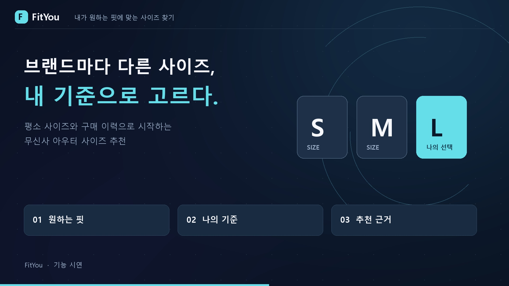
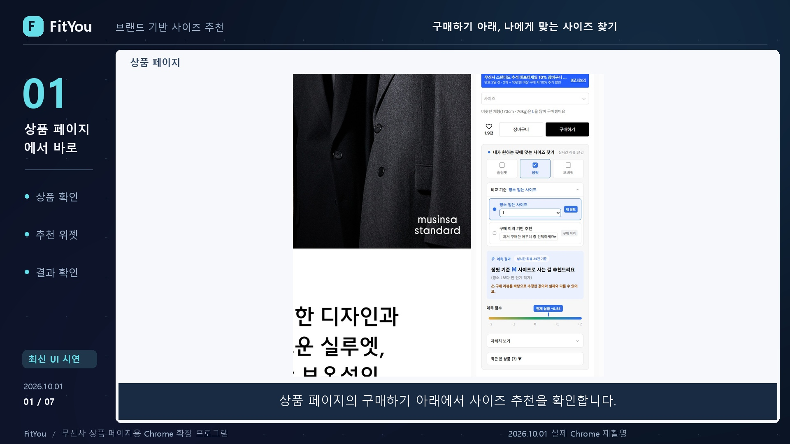
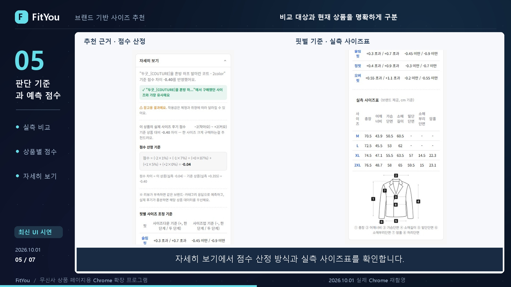
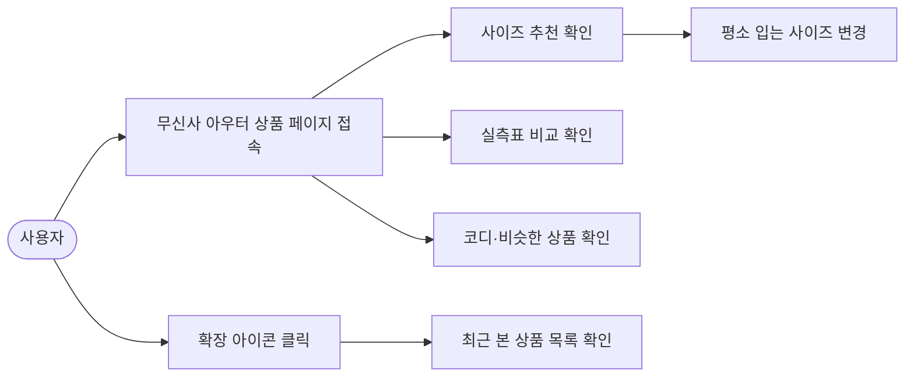
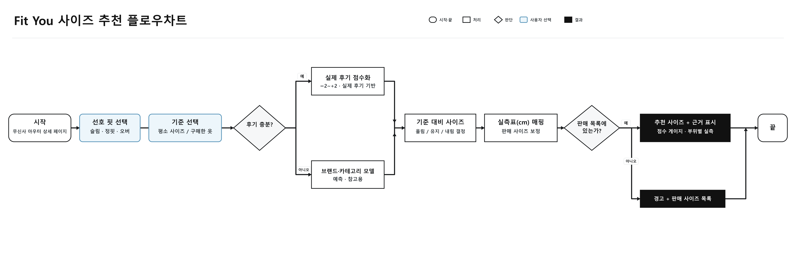
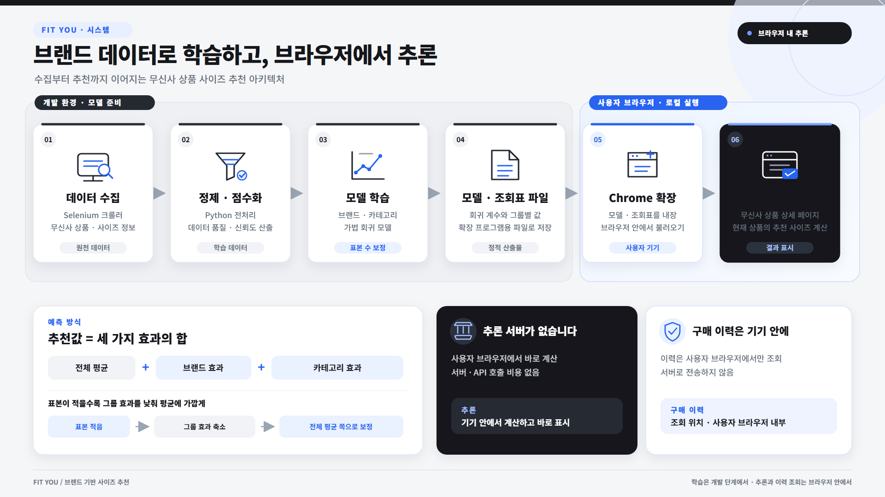
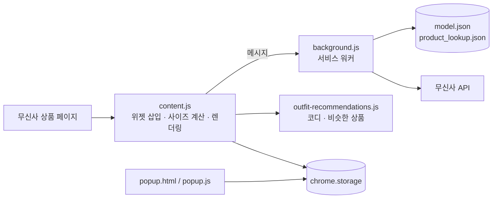

# Fit You — 브랜드 사이즈·코디 추천 위젯 (무신사)

> 무신사 아우터 상품 페이지에서 사이즈 고민을 줄여주는 Chrome 확장 프로그램



## 1. 프로젝트 개요

**주제**: 리뷰 여론과 실측 사이즈표를 활용한 아우터 사이즈 추천 서비스

- 무신사 아우터 상품 페이지의 "구매하기" 버튼 아래에 추천 위젯을 삽입합니다.
- 브랜드·상품별 리뷰 여론을 점수화하고, 내가 평소 입는 사이즈와 구매 이력을 기준으로 사이즈를 추천합니다.
- 사이즈 추천과 함께 어울리는 코디 세트와 비슷한 상품도 보여줍니다.

## 2. 주요 기능

### 개발 목표

- 아우터를 온라인에서 살 때 "내 사이즈가 맞을까?"라는 불확실성을 줄인다.
- 상품 페이지를 벗어나지 않고 그 자리에서 사이즈 판단 근거를 확인하게 한다.

### 개발 내용

| 기능 | 설명 |
|------|------|
| 사이즈 추천 | 리뷰 여론을 −2(작아요) ~ +2(커요) 점수로 계산하고 평소 입는 사이즈·구매 이력 기준으로 추천 |
| 실측표 비교 | 상품 페이지의 실측 사이즈표를 읽어 cm 단위로 비교 근거 제시 |
| 번호 사이즈 매핑 | `1`~`4` 같은 번호 사이즈는 상품별 실측표 기반 매핑을 우선하고, 구분이 안 되면 기존 매핑을 쓰되 근사값임을 표시 |
| 실제 판매 사이즈 우선 | `F`/`FREE`는 원문 그대로 표시. 계산된 사이즈가 판매 목록에 없으면 다른 사이즈로 대체하지 않고 경고와 판매 사이즈 목록 표시 |
| 기준 즉시 전환 | "평소 입는 사이즈" 드롭다운을 바꾸면 바로 다시 계산 |
| 코디·비슷한 상품 | 무신사 상품 상세 API 기반으로 코디 세트와 비슷한 상품 표시 |
| 최근 본 상품 | 확장 아이콘 팝업에서 최근 본 상품 목록 확인 |

### 화면

**상품 페이지의 구매하기 버튼 아래에 위젯이 삽입됩니다.**



**자세히 보기에서 점수 산정 방식과 실측 사이즈표를 확인합니다.**



## 3. 개발환경

| 구분 | 내용 |
|------|------|
| 플랫폼 | Chrome 확장 프로그램 (Manifest V3) |
| 사용 언어 | JavaScript, HTML, CSS |
| 사용 라이브러리 | 없음 (순수 JavaScript, Shadow DOM 위젯) |
| 데이터 | `model/model.json`(브랜드 사이즈 모델), `model/product_lookup.json`(상품 조회표) |
| 저장소 | `chrome.storage` (최근 본 상품, 평소 입는 사이즈 등) |
| 테스트 | Node.js 스모크 테스트 |

## 4. 유스케이스



### 추천 흐름



## 5. 서비스 아키텍처



### 확장 프로그램 구조



### 파일 구성

| 파일 | 역할 |
|------|------|
| `manifest.json` | 확장 프로그램 설정 (권한, 콘텐츠 스크립트 등록) |
| `content.js` | 상품 페이지에 주입되어 위젯 삽입·사이즈 계산·렌더링 |
| `background.js` | 서비스 워커. 모델 데이터 로드와 무신사 API 요청 중계 |
| `outfit-recommendations.js` | 코디·비슷한 상품 추천 |
| `widget.html.js` / `style.css` | 위젯 마크업 / 스타일 |
| `popup.html` / `popup.js` / `popup.css` | 최근 본 상품 팝업 |
| `tests/` | 스모크 테스트 |

## 설치 방법 (개발자 모드)

1. 이 저장소를 내려받습니다.
2. Chrome에서 `chrome://extensions`를 엽니다.
3. 우측 상단 **개발자 모드**를 켭니다.
4. **압축해제된 확장 프로그램을 로드합니다**를 눌러 이 폴더를 선택합니다.
5. 무신사 아우터 상품 페이지(`https://www.musinsa.com/products/...`)에 접속하면 위젯이 나타납니다.

## 테스트

```
node tests/red-team.smoke.test.js
```

## 유의사항

- 무신사 공식 서비스가 아니며, 추천 결과는 참고용입니다.
- 무신사 페이지 구조가 바뀌면 동작이 달라질 수 있습니다.
